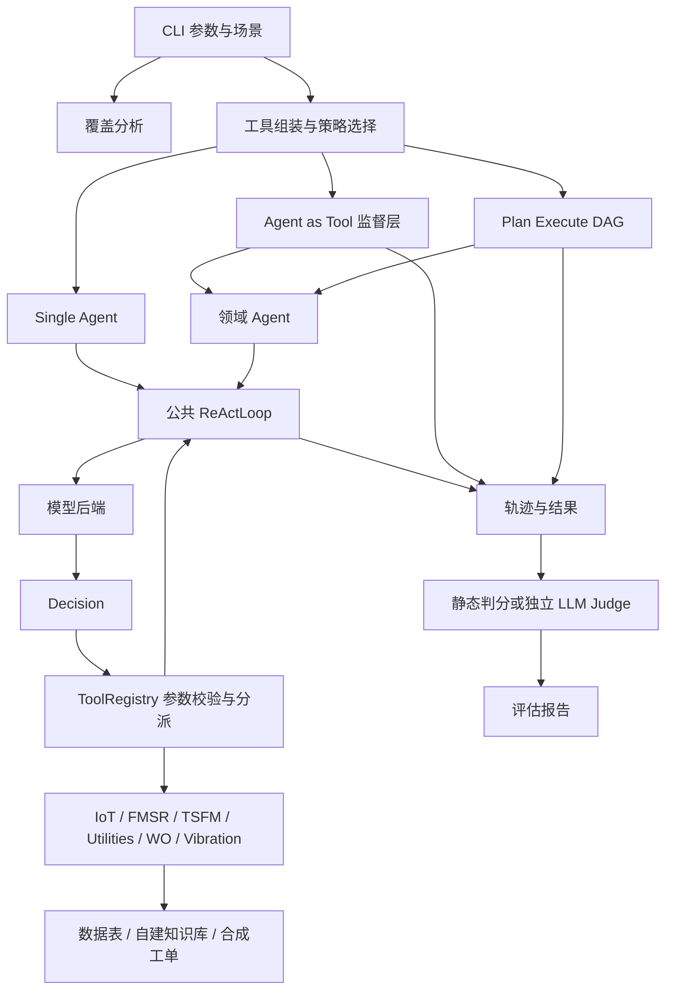

# 代码架构与调用关系

## 模块职责

| 模块 | 关键对象 | 输入与输出 |
|---|---|---|
| cli.py | build_parser、cmd_run_suite、cmd_evaluate | 命令参数 → 覆盖表、轨迹或报告 |
| contracts | Scenario、Decision、ToolCall、ToolResult、RunResult | 场景/决策/执行结果契约 |
| data/repositories.py | DataRoot、AssetRepo、TelemetryRepo | CSV/JSON → 资产、传感器与时间序列 |
| data/coverage.py | classify、summarize | 场景 + 本地目录 → 覆盖状态 |
| models | ScriptedBackend、OpenAIBackend | 消息与工具 schema → Decision |
| agents/react_loop.py | ReActLoop、run_single | 场景 → 工具交互与终态答复 |
| tools/registry.py | ToolSpec、ToolRegistry | 校验参数、白名单调度 → ToolResult |
| tools/* | 六域工具与 distractors | 本地仓库/知识库 → 可验证工具结果 |
| orchestration/wiring.py | build_toolset、build_orchestrator | 策略和配置 → 编排器 |
| orchestration/agent_as_tool.py | DomainAgent、监督编排器 | 子任务 → 领域答复 → 汇总 |
| orchestration/plan_execute.py | PlanStep、StepOutcome、parse_plan | DAG → 执行/复核/综合 |
| trace/recorder.py | TrajectoryRecorder | 事件与终态结果 → JSONL/JSON |
| evaluation | static_json、DeepSeekJudge | 场景 + 已落盘轨迹 → 分数与通过状态 |

根级 react_loop.py、judge.py 仅作兼容转发，避免重复实现。

## 失败处理

工具缺失、参数不合法和数据不足返回明确错误，模型可以据此调整。DAG 成环与重复 ID 由 PlanError 拒绝；上游节点失败时跳过依赖节点。模型服务重试在后端处理。判官解析错误保留独立状态。

详细数据边界见 REPRODUCTION.md。完整领域内工具事件尚未全部记录，不能仅凭外层计数恢复全部内层对话。
